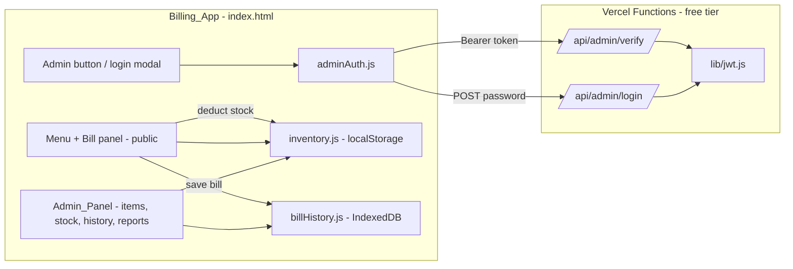
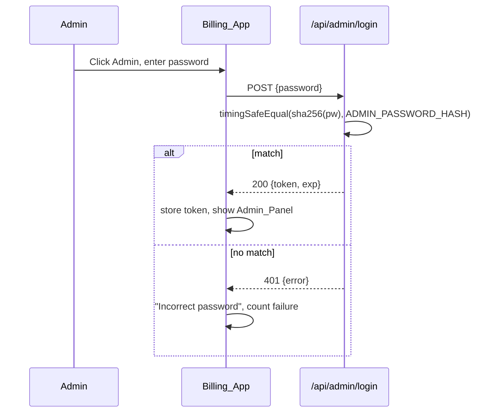

# Design Document

## Overview

The Billing_App stays public for billing. An "Admin" button opens a password login. The password is checked by two small Vercel Serverless Functions (free on the Hobby plan you already deploy to), which sign and verify a JWT using HMAC-SHA256. No paid backend, database, or extra cloud service is needed.

Menu items move from the hard-coded `MENU` array into an Inventory stored in the browser (localStorage). The built-in list seeds the Inventory on first run. The Admin_Panel edits prices, adds items, toggles availability, and manages stock. History and Reports drawers move behind the admin gate.

Key decisions:

- Vercel Functions for auth: the password and JWT secret live in Vercel environment variables, never in files sent to the browser (Req 3.5). A purely client-side JWT would expose the secret and is not real authentication.
- Node built-in `crypto` for JWT: HS256 is ~30 lines with `createHmac` and `timingSafeEqual`, so no new dependency.
- localStorage for Inventory: matches how the app already stores settings, works offline, zero cost. Export/Import JSON covers backup and moving to another device (Req 8.4).
- Stateless verification: `/api/admin/verify` checks signature and expiry, so no session store is needed.

Limitation to be aware of: bill history (IndexedDB) and Inventory live in the browser. The JWT gate controls the app UI and admin actions, but a person with browser devtools on that computer could still read local data. Fully protecting data would require server-side storage, which is out of scope for a zero-cost setup.

## Architecture



Login flow:



## Components and Interfaces

### `lib/jwt.js` (server, CommonJS)

```js
sign(payload, secret, ttlSeconds) -> string        // header.payload.signature, base64url
verify(token, secret, nowSeconds?) -> payload|null // null if malformed, bad signature, or expired
checkPassword(input, expectedSha256Hex) -> boolean // constant-time compare
```

### `api/admin/login.js` (Vercel Function)

- `POST` body `{ "password": string }`
- Env: `ADMIN_PASSWORD_HASH` (sha256 hex), `JWT_SECRET` (min 32 chars)
- 200 `{ token, exp }` with `exp = iat + 8h` (Req 2.2)
- 401 `{ error: "Incorrect password" }` (Req 2.4)
- 500 if env vars missing; 405 for non-POST
- Adds a ~400 ms delay on failure to slow brute force

### `api/admin/verify.js` (Vercel Function)

- `GET` with `Authorization: Bearer <token>`
- 200 `{ valid: true, exp }` or 401 `{ valid: false }` (Req 3.1–3.3)

### `adminAuth.js` (browser, exposes `window.AdminAuth`)

```js
login(password) -> Promise<{ok, error?, lockedForMs?}>
logout() -> void
isActive() -> boolean                      // token present and exp in future (local check)
validate() -> Promise<boolean>             // calls /api/admin/verify; clears token on failure
requireAdmin(onGranted) -> Promise<void>   // validate, else open login modal
onChange(listener) -> void                 // UI toggles admin controls
```

- Token stored in `localStorage` key `bfs_admin_token`.
- Lockout: failures stored in `bfs_admin_fail` as `{count, firstAt, lockedUntil}`; 5 failures within 15 min locks for 15 min (Req 2.5).
- Auto-logout timer fires at `exp` (Req 3.3).

### `inventory.js` (browser, exposes `window.Inventory`)

```js
load(seedMenu) -> Item[]                   // seeds when empty (Req 8.1, 8.2)
getAll() -> Item[]
getAvailable() -> Item[]                   // for menu grid (Req 6.5)
updatePrice(id, price) -> Result           // Req 5.2, 5.3
addItem(fields) -> Result                  // Req 6.2, 6.3
setAvailable(id, bool) -> Result           // Req 6.4
setTracking(id, enabled, qty, threshold) -> Result
restock(id, amount) -> Result              // Req 7.2
deductForBill(billItems) -> void           // Req 7.3, floor at 0
exportJson() -> string ; importJson(text) -> Result  // Req 8.4, 8.5
onChange(listener) -> void                 // re-render menu within 1s (Req 5.2)
```

`Result` is `{ ok: true, item }` or `{ ok: false, error: string }`. Validation logic is pure and testable in Node.

### `index.html` changes

- Replace `const MENU = [...]` usage with `DEFAULT_MENU` seed plus `Inventory.getAvailable()`; menu card shows "Out of stock" when tracked qty is 0 (Req 7.5).
- Header: hide History/Reports buttons until admin active; add "Admin" / "Logout" buttons (Req 1.3, 1.4, 3.4).
- `openHistDrawer` / `openRptDrawer` wrapped with `AdminAuth.requireAdmin` (Req 4.3).
- Login modal and Admin_Panel drawer reusing existing `.modal` and `.hist-drawer` styles.
- After `BillHistory.saveBillRecord` resolves, call `Inventory.deductForBill(billItems)`. Bill records already snapshot item prices, so old bills stay unchanged (Req 5.5).

## Data Models

```ts
// localStorage "bfs_inventory_v1"
interface InventoryFile { version: 1; nextId: number; items: Item[] }

interface Item {
  id: number;            // unique, from nextId
  name: string;          // non-empty, unique case-insensitive
  emoji: string;
  price: number;         // 1..100000
  cat: string;           // e.g. Juices, Shakes, Snacks, Specials
  specs: string[];       // e.g. ["ice","sugar"]
  available: boolean;    // default true
  stock: { tracked: boolean; qty: number; lowAt: number }; // ints >= 0
}

// JWT payload
interface AdminClaims { sub: "admin"; iat: number; exp: number }
```

## Error Handling

| Case | Behavior |
|---|---|
| Wrong password | 401, "Incorrect password", failure counted |
| 5 failures in 15 min | Login form disabled, countdown shown |
| Expired/invalid/tampered token | Token cleared, panel closed, Admin button shown |
| `/api` unreachable (offline) | Login shows "Cannot reach login server"; billing unaffected. A stored token that is still unexpired locally keeps the session until `exp` |
| Missing env vars | 500 "Server not configured", logged on Vercel |
| Invalid price / duplicate or empty name | Inline error, no save |
| Invalid import file | "Invalid inventory file", current Inventory kept |
| localStorage blocked | Falls back to built-in menu in memory, warning in console (uses existing `safeGetStorage` pattern) |

## Testing Strategy

Uses the existing `node --test` runner.

- `test/admin-jwt.test.js`: sign/verify round trip, expired token rejected, tampered signature rejected, malformed token rejected, password check.
- `test/inventory.test.js`: seed on empty, price bounds, duplicate name rejection, stock deduction floors at 0, import rejects bad JSON. `inventory.js` will accept an injected storage object so it runs in Node.
- Login/verify handlers tested by calling the exported function with mock `req`/`res` objects.

## Setup (for implementation)

- Vercel env vars: `ADMIN_PASSWORD_HASH` and `JWT_SECRET`. A helper script `scripts/hash-password.mjs` prints the hash for a chosen password.
- `.gitignore` already guards local secrets; nothing secret is committed.
