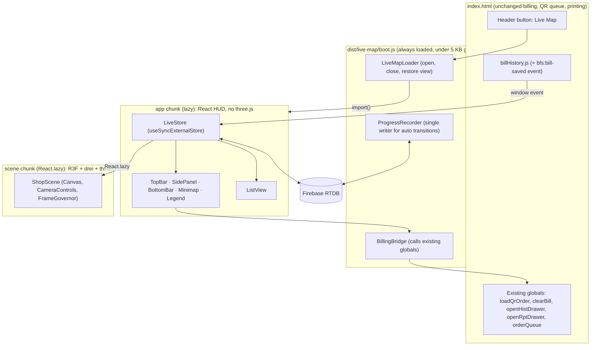
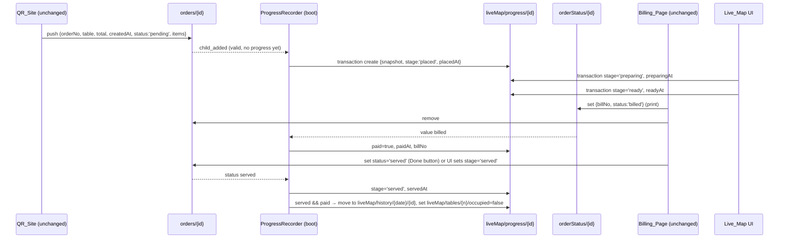

# Design Document

## Overview

The Live Map is a full-screen strategy-game view of the BFS shop. It is built inside the existing static billing site and does not replace any of it. The design has four parts:

- A small always-on boot script on the billing page (`dist/live-map/boot.js`, under 5 KB). It records order progress in Firebase and opens or closes the Live Map.
- A lazily loaded React and TypeScript app (`LiveMapApp`). It is fetched by a dynamic `import()` only when the owner presses the existing "Live Map" header button.
- A further lazily loaded React Three Fiber scene chunk (`ShopScene`). It is wrapped in `React.lazy` and `Suspense`, which is this codebase's equivalent of `next/dynamic` with `ssr: false`, and shows a HUD-styled skeleton while it loads.
- A new `liveMap` node in Firebase. It holds table occupancy and per-order progress. The existing `orders` and `orderStatus` nodes are only ever read, never written.

### Research findings that drive the design

| Finding (source) | Consequence |
|---|---|
| Static `index.html`, Vercel `framework: null`, esbuild build (`package.json`, `vercel.json`) | TypeScript is compiled by esbuild (native TS and TSX support). esbuild `--splitting --format=esm` provides the code-split chunks. No Next.js. |
| React 19, R3F 9.8, drei 10.7, three 0.186 already installed (`npm ls`) | No new runtime dependencies. Add pinned dev dependencies only: `typescript`, `@types/react`, `@types/react-dom`, `@types/three`. |
| drei ships `CameraControls` (camera-controls), `Html` and `Instances` | Use `CameraControls` for damped orbit, pan and zoom, the boundary box and the smooth animated reset. Use `Html` for markers. Use `Instances` for chairs, crates and tiles. |
| `renderQueue()` treats `status === 'preparing'` as already printed (`index.html`) | No new values are written to `orders/{id}/status`. Flow stages live in `liveMap/progress`. |
| Printing writes `orderStatus/{id}={billNo,status:'billed'}` and then removes `orders/{id}` (`index.html`) | The boot recorder snapshots each order into `liveMap/progress/{id}` as soon as it appears, and the Live Map reads that snapshot afterwards. |
| The Done button writes `orders/{id}/status='served'`, even after the order was removed (`completeOrder`) | The recorder treats the existence of an `orders/{id}/status === 'served'` record as a served signal. Stub records without `table` or `createdAt` are never shown (Req 1.6). |
| Bills are saved to IndexedDB via `window.BillHistory.saveBillRecord`, with no change event | Add one line to `billHistory.js` that dispatches `bfs:bill-saved` after a successful save. Billing behaviour is unchanged. |
| Theme variables live in `:root` of `index.html` | The HUD CSS uses `var(--accent)` and the other variables directly. The scene reads the same variables through `getComputedStyle` at mount. |
| Node 24 runs `.ts` files natively (type stripping) | Pure `lib` modules are tested with `node --test` and no extra tooling. Those modules avoid `enum` and `namespace`. |
| The existing `map3d/*.js` contains simulated data (random timestamps) and duplicated inline code in `index.html` (about 450 lines) | These are replaced by the new modules (see the migration of existing code below). |

### Key decisions

1. **Single writer for automatic transitions.** Only the boot recorder creates, advances (served and paid signals) and closes Progress_Records. The Live Map UI writes only the stage changes and `occupied` toggles that the owner makes, so concurrent tabs stay consistent (writes use transactions).
2. **Bounded reads.** Only active Progress_Records are kept under `liveMap/progress`. Closed records move to `liveMap/history/{YYYY-MM-DD}/{id}`. Paid detection uses one `orderStatus/{id}` listener per active order, never the whole `orderStatus` node.
3. **Overlay, not route.** The Live Map is a fixed full-screen layer in `index.html`. Billing_Focus moves the layer behind the billing UI (same stacking slot as the existing `gradient-waves-bg`) and dims it, so all billing screens stay usable in front.
4. **One store, many views.** A framework-free `LiveStore` (lib) holds the merged state. React reads it through `useSyncExternalStore`, so the Map_Scene, HUD, Minimap and List_View render the same data.

## Architecture

### Runtime layers



### Firebase data flow



The recorder runs on every open billing tab. Because each write is a transaction keyed on the current record (create only if the record is absent, close only if it is still present), duplicate tabs produce the same end state without double entries.

### Order flow and status mapping

| Flow step | Data condition | Table_Status | Who writes |
|---|---|---|---|
| (none) | No Active_Order, `occupied=false` | Free | — |
| (none) | No Active_Order, `occupied=true` | Occupied | Owner (Live Map toggle) |
| Placed | `stage='placed'` | Order_Placed | Recorder on `orders` child_added |
| Preparing | `stage='preparing'` | Preparing | Owner (Live Map) |
| Ready | `stage='ready'` | Ready_To_Serve | Owner (Live Map) |
| Served | `stage='served'`, `paid=false` | Needs_Bill | Owner (Live Map) or Recorder on `orders/{id}/status='served'` |
| Paid (before served) | `paid=true`, stage not served | Stage colour + "Paid" badge | Recorder on `orderStatus/{id}='billed'` |
| Paid + served | both | Free (record closed) | Recorder |

New status values: three new stages (`preparing`, `ready`, `served`) in the new `liveMap/progress` node. Nothing new is added to `orders/{id}/status`.

When a table has more than one Active_Order, the oldest one is the primary order. The primary order drives the colour and the marker, and the marker shows a `+N` badge for the rest.

### View modes and layering

| View_Mode | Live Map layer | HUD | Scene rendering |
|---|---|---|---|
| Closed | Unmounted (GPU freed) | — | none |
| Balanced | `position:fixed; inset:0; z-index:900` | opacity 1 | `frameloop="always"` |
| Map_Focus | same | opacity 0.2, 1 on `:hover` / `:focus-within` (300 ms) | always |
| Billing_Focus | `z-index:0; pointer-events:none` (the slot of `.gradient-waves-bg`), canvas filter `brightness(.25)` | hidden, except a "Back to map" pill (z-index 900) | `demand` + `invalidate()` every 100 ms (10 fps) |
| Tab hidden | unchanged | unchanged | `never` |

Quick actions (new bill, queue, reports, history) and the Bill button switch to Billing_Focus first and then call the existing global. Drawers, modals and print toasts therefore appear in front exactly as they do today. The last View_Mode is saved in `localStorage['bfs.liveMap.view']`. On reload, if the saved mode is not Closed, the loader reopens the map after `requestIdleCallback`, so the first paint of billing is unaffected.

### Build and bundle layout

```
esbuild map3d/boot.ts map3d/app.tsx --bundle --splitting --format=esm --minify
        --target=es2020 --jsx=automatic --outdir=dist/live-map
        --entry-names=[name] --chunk-names=chunks/[name]-[hash] --metafile=dist/live-map/meta.json
```

| Output | Contents | Budget (gzip) |
|---|---|---|
| `dist/live-map/boot.js` | recorder, bridge, loader | ≤ 5 KB |
| `dist/live-map/app.js` + `app.css` | React (~67 KB on its own), HUD, ListView, store | ≤ 90 KB |
| `dist/live-map/chunks/ShopScene-*.js` | three, R3F, drei modules used | ≤ 310 KB |
| Total | | ≤ 400 KB |

`scripts/check-bundle-size.mjs` reads `meta.json`, gzips each output and fails the build if a budget is exceeded. three, R3F and drei are imported only through named imports inside `map3d/scene/`, so esbuild tree-shakes unused modules. `tsc --noEmit` runs as `npm run typecheck`.

## Components and Interfaces

### Folder structure (inside existing `map3d/`)

```
map3d/
  boot.ts                 entry 1: recorder + bridge + loader (no React)
  app.tsx                 entry 2: mount(el) / unmount() for LiveMapApp
  lib/                    framework-free TS, unit-tested with node --test
    types.ts              shared types (below)
    layout.ts             SHOP_LAYOUT: 8 tables, 3 counters, walls, staff path, bounds
    status.ts             deriveTableStatus(), STATUS_META (label, colour token)
    orders.ts             normalizeOrder(), isValidOrder(), itemPrefs()
    progress.ts           pure transition fns: createFrom(), withStage(), withPaid(), isClosable()
    firebase.ts           getDb(), paths, runTxn() wrapper over window.firebase compat
    recorder.ts           ProgressRecorder (uses progress.ts + firebase.ts)
    store.ts              LiveStore: subscribe/getSnapshot, merges progress+tables+connection+sales
    counters.ts           openCount(), avgPrepMinutes(), todaySales()
    events.ts             diffToEvents(prev, next) → MapEvent[] (ring buffer of 8)
    bridge.ts             BillingBridge: typed calls to existing globals
    format.ts             elapsed(), money(), shortOrderNo()
    webgl.ts              hasWebGL() (WebGL2 or WebGL1 context, no extension demands)
    theme.ts              readTheme() from CSS vars → SceneTheme
  hooks/
    useLiveStore.ts       useSyncExternalStore selector hook
    useNow.ts             1 Hz shared ticker (one interval for all markers)
    useViewMode.ts        view mode state + localStorage persistence
    useTabVisible.ts      document.visibilitychange
    useReducedMotion.ts   prefers-reduced-motion
  ui/
    LiveMapApp.tsx        root: layout grid, Suspense, error boundary, keyboard (Esc)
    TopBar.tsx            counters, offline pill, view toggle, close
    SidePanel.tsx         OrderList | OrderPanel
    OrderList.tsx
    OrderPanel.tsx        items, stage buttons, Bill, Occupied toggle
    BottomBar.tsx         quick actions + EventsFeed
    EventsFeed.tsx        aria-live="polite"
    Minimap.tsx           SVG from SHOP_LAYOUT
    Legend.tsx
    ListView.tsx          2D table grid (fallback)
    LoadingSkeleton.tsx
    SceneBoundary.tsx     error boundary → ListView
    live-map.css          HUD styles using existing CSS vars
  scene/
    ShopScene.tsx         <Canvas dpr={[1,1.5]}>, lights, composes everything
    CameraRig.tsx         drei CameraControls, bounds, reset, idle drift
    FrameGovernor.tsx     frameloop control (tab hidden, Billing_Focus)
    materials.ts          shared flat-shaded materials from SceneTheme
    Floor.tsx             instanced tiles
    Walls.tsx
    TableEntity.tsx       top + legs, colour lerp, hover, click
    Chairs.tsx            one <Instances> for all chairs
    BillingCounter.tsx
    JuiceStation.tsx      juicer + <FruitCrates> + JuicePour
    FruitCrates.tsx       instanced crates + instanced fruit
    SnackCounter.tsx      + Steam
    Steam.tsx             instanced puffs, shader-free (scale/opacity loop)
    JuicePour.tsx         visible while any order is preparing
    StaffFigure.tsx       walks SHOP_LAYOUT.staffPath (Catmull-Rom curve)
    StatusMarker.tsx      drei <Html> label
    SelectionRing.tsx     emissive torus, pulsing
    OrderPulse.tsx        expanding ring for 1.5 s on new order
    Tooltip.tsx           drei <Html> on hover
```

### Core types (`lib/types.ts`)

```ts
export type TableStatus =
  | 'free' | 'occupied' | 'order_placed' | 'preparing' | 'ready_to_serve' | 'needs_bill';

export type Stage = 'placed' | 'preparing' | 'ready' | 'served';
export type ViewMode = 'closed' | 'balanced' | 'map_focus' | 'billing_focus';

export interface OrderItem {
  name: string; qty: number; price: number; total: number;
  emoji?: string; prefs: string[];            // from ice/sugar/size/note/spec
}

export interface ProgressRecord {
  orderId: string;                            // = orders/{id} key
  orderNo: string; table: string; total: number; createdAt: number;
  items: OrderItem[];
  stage: Stage;
  placedAt: number; preparingAt?: number; readyAt?: number; servedAt?: number;
  paid: boolean; paidAt?: number; billNo?: string;
  updatedAt: number;
}

export interface TableRecord { number: string; label: string; seats: number; occupied: boolean; }

export interface TableView {
  number: string; status: TableStatus; primary?: ProgressRecord; extraOrders: number; paid: boolean;
}

export interface MapEvent {
  id: string; at: number; table: string;
  kind: 'new' | 'stage' | 'paid' | 'closed' | 'error'; text: string;
}

export interface LiveSnapshot {
  connected: boolean; ready: boolean;
  orders: ProgressRecord[];                   // active, sorted by createdAt asc
  tables: TableView[];                        // always 8, layout order
  counters: { open: number; avgPrepMin: number | null; todaySales: number };
  events: MapEvent[];                         // newest first, max 8
  pulses: { table: string; at: number }[];    // new-order pulses < 1.5 s old
  selected: string | null;                    // table number
}
```

### Key interfaces

```ts
// lib/status.ts
export function deriveTableStatus(t: TableRecord, active: ProgressRecord[]): TableView;
export const STATUS_META: Record<TableStatus, { label: string; color: string; cssVar: string }>;

// lib/progress.ts (pure, used by recorder and UI)
export function createFrom(orderId: string, raw: unknown, now: number): ProgressRecord | null;
export function withStage(p: ProgressRecord, s: Stage, now: number): ProgressRecord;
export function withPaid(p: ProgressRecord, billNo: string | undefined, now: number): ProgressRecord;
export function isClosable(p: ProgressRecord): boolean;      // stage==='served' && paid

// lib/recorder.ts
export function startRecorder(db: Database): () => void;     // returns stop()

// lib/store.ts
export interface LiveStore {
  subscribe(cb: () => void): () => void;
  getSnapshot(): LiveSnapshot;
  select(table: string | null): void;
  setStage(orderId: string, s: Stage): Promise<void>;        // optimistic + rollback
  setOccupied(table: string, v: boolean): Promise<void>;
  dispose(): void;
}
export function createLiveStore(db: Database | null, now?: () => number): LiveStore;

// lib/bridge.ts (only touchpoint with existing billing code)
export const BillingBridge: {
  billOrder(orderId: string): boolean;   // window.loadQrOrder if order is in orderQueue
  newBill(): void;                       // focus menu/bill area; window.clearBill()
  showQueue(): void;                     // scrollIntoView #oqList
  openReports(): void;                   // window.openRptDrawer()
  openHistory(): void;                   // window.openHistDrawer()
};

// app.tsx
export function mount(el: HTMLElement, opts: { view: ViewMode; onView(v: ViewMode): void }): void;
export function unmount(): void;
```

The Bill button appears only when the primary order is not yet paid and `BillingBridge.billOrder` can find it in `window.orderQueue`, which means it has not been printed yet. Otherwise the panel shows "Billed #<billNo>".

### Scene components

| Component | Technique | Requirement |
|---|---|---|
| `ShopScene` | `<Canvas dpr={[1,1.5]} flat gl={{antialias:true, powerPreference:'low-power'}} camera={{fov:35}}>`, one hemisphere and one directional light, no shadow maps (baked contact darkening via a darker floor patch) | 3, 17.1 |
| `Floor` | `<Instances limit={160}>` of 1×1 boxes in a 2-tone checker | 3.1, 17.2 |
| `Chairs` | one `<Instances>` with 4 chairs per table (32 instances), with positions from `SHOP_LAYOUT` | 3.1, 17.2 |
| `FruitCrates` | `<Instances>` crates plus `<Instances>` icosahedron fruit (detail 0) | 3.1, 17.2 |
| `TableEntity` | `meshStandardMaterial flatShading`. In `useFrame`, `color.lerp(target, 1 - exp(-dt/0.12))`, which settles in about 600 ms with no jump. Hover raises the table 0.05 units | 5.2, 5.3 |
| `StatusMarker` | drei `<Html center distanceFactor={10} zIndexRange={[20,0]}>`, a `.lm-marker` black panel with gold text. Elapsed time comes from the shared `useNow` | 6 |
| `SelectionRing` | torus with `meshBasicMaterial` in gold, opacity pulsing 0.5–1 | 7.2 |
| `OrderPulse` | ring scaling 1→3 and fading over 1.5 s, unmounts afterwards | 14.4 |
| `Tooltip` | drei `<Html>` on `onPointerOver` / `onPointerOut` | 14.3 |
| `Steam` | 6 instanced spheres rising and fading on a sine-offset loop | 4.1 |
| `JuicePour` | cylinder stream with scale.y animation, mounted while `orders.some(stage==='preparing')` | 4.2 |
| `StaffFigure` | capsule body and sphere head following a `CatmullRomCurve3` closed loop at 0.6 u/s, facing the tangent, with a bob on y | 4.3 |
| `CameraRig` | drei `<CameraControls>` with `minDistance=6`, `maxDistance=22`, `minPolarAngle=20°`, `maxPolarAngle=65°`, `smoothTime=0.25` and `setBoundary(Box3(floor))`. `reset(true)` gives about an 800 ms animated return. Idle drift after 10 s without a `controlstart` event: `setLookAt` offset by `0.4·sin(t/8)`. Disabled under reduced motion and in Billing_Focus | 4.4, 13 |
| `FrameGovernor` | sets `frameloop` via `useThree(s => s.setFrameloop)`: `never` when the tab is hidden, `demand` plus a 100 ms `invalidate` interval in Billing_Focus, `always` otherwise | 17.3, 17.4 |

### HUD layout

```
┌───────────────────────── TopBar ─────────────────────────────┐
│ BFS Live · ● Live | Open 4 | Avg prep 6m | Today ₹2,340 | ◐ ✕ │
├──────────┬────────────────────────────────────┬──────────────┤
│ Minimap  │                                    │  SidePanel   │
│ Legend   │          Map_Scene / ListView      │  OrderList   │
│          │                                    │  or          │
│          │                                    │  OrderPanel  │
├──────────┴────────────────────────────────────┴──────────────┤
│ BottomBar: [New bill][Queue][Reports][History] [⟲][◐][☰] Feed│
└──────────────────────────────────────────────────────────────┘
```

The HUD panels use `background: rgba(1,1,1,.62)`, `border:1px solid var(--border)`, `backdrop-filter: blur(8px)`, with `var(--accent)` for headings and `var(--text)` for body text. All controls are `<button>` elements with visible `:focus-visible` gold outlines and `aria-label`s. Table colours are always paired with a text label in the HUD and markers, so status is never conveyed by colour alone. Below 900 px width the SidePanel becomes a bottom sheet and the Minimap is hidden.

### Status palette (theme-harmonised)

| Status | Colour | Rationale |
|---|---|---|
| Free | `#3a3530` warm charcoal | recedes on black |
| Occupied | `#8c7a5b` muted bronze | "someone's here", calm |
| Order_Placed | `#e8bd58` (`--accent-cta`) | gold attention |
| Preparing | `#d98a3e` amber | warm, active |
| Ready_To_Serve | `#6fbf73` soft green | go |
| Needs_Bill | `#d96b55` (`--accent-2`) | action needed |

## Data Models

### Firebase RTDB (new `liveMap` node only)

```jsonc
{
  "liveMap": {
    "schemaVersion": 1,
    "tables": {
      "1": { "number": "1", "label": "Table 1", "seats": 4, "occupied": false }
      // ... 2–8
    },
    "progress": {
      "<orderId>": {
        "orderNo": "QR-LX2…", "table": "3", "total": 180, "createdAt": 1760160000000,
        "items": [{ "name": "Mango Juice", "qty": 2, "price": 60, "total": 120, "emoji": "🥭", "prefs": ["Less Sugar"] }],
        "stage": "preparing",
        "placedAt": 1760160000500, "preparingAt": 1760160090000,
        "paid": false, "updatedAt": 1760160090000
      }
    },
    "history": {
      "2026-10-11": { "<orderId>": { /* closed ProgressRecord + closedAt */ } }
    }
  }
}
```

Existing nodes are read and never written by new code:

- `orders/{id}`: snapshot source plus the served signal. A record is valid when it has a non-empty `table` and a numeric `createdAt`.
- `orderStatus/{id}`: paid signal (`status === 'billed'`). It is read per active order.

### Migration and seed

`migrations/001-live-map-tables.json` imports at path `/liveMap` and contains `schemaVersion` plus the 8 tables. Table numbers 1 to 8 match the QR site's `?table=` values. The suggested seats are 4,4,2,2,6,6,2,2, which the owner can edit.

`migrations/001-live-map-tables.mjs` is an optional scripted alternative. It uses the REST API with `?auth=<DB secret or ID token>`, reads `/liveMap/tables.json`, and only `PUT`s when the node is empty, so it is safe to run more than once.

`migrations/database.rules.example.json` contains suggested rules that keep the current open model and add validation for `liveMap/*`, covering types, `stage` enum values and the `occupied` boolean. Nothing is deployed automatically, and the owner applies the rules manually (see Deployment).

### Layout (`lib/layout.ts`)

The floor is 14×10 units, centred on the origin. The billing counter is near the entrance (front-centre), the juice station is back-left with the juicer and 6 crates, and the snack counter is back-right with a steam point. Tables 1–8 sit in two rows of four, with chairs around each. `staffPath` is a closed loop through billing → juice → snack → between the table rows. `bounds` is the floor box minus a 1-unit margin, and both `CameraRig.setBoundary` and the Minimap use it.

### Store derivation

The `LiveStore` subscribes to `liveMap/progress` (`value`), `liveMap/tables` (`value`) and `.info/connected`. It listens for `bfs:bill-saved` and reads today's records once on mount through `window.BillHistory.getBillRecordsByDateRange(today, today)`. Firebase callbacks are coalesced with `queueMicrotask` into one snapshot rebuild, so updates reach React within the same tick, well under the 1-second target. `deriveTableStatus` combines each `TableRecord` with its active orders, and `diffToEvents` compares the previous and next snapshot to produce events and pulses.

Counter definitions:

- Open orders = the number of active Progress_Records.
- Average prep = the mean of `readyAt - createdAt` over today's records that have `readyAt`, both active and in `history/{today}`. History is read once with `once('value')` and then incrementally on close. It shows "—" when no records qualify.
- Today's sales = the sum of `amount` in today's Bill_History_Store records.

## Error Handling

| Failure | Detection | Behaviour | Req |
|---|---|---|---|
| WebGL unavailable | `hasWebGL()` before rendering the scene | ListView with notice "3D unavailable on this device" | 16.1 |
| Scene throws (shader, context lost) | `SceneBoundary` error boundary plus `webglcontextlost` listener | ListView, plus a "Retry 3D" button in the BottomBar | 16.5 |
| App chunk fails to load (offline, deploy race) | `import()` rejects in the loader | Inline HUD-styled panel with a Retry button. Billing is unaffected | 2.4 |
| Scene chunk fails to load | `React.lazy` rejects → boundary | ListView with Retry | 2.4 |
| Firebase missing (`!window.firebaseConfig`) | `getDb()` returns null | Recorder disabled. Store shows offline with an empty map, and the ListView still renders | 15.2 |
| Disconnected | `.info/connected === false` | Offline pill in the TopBar, last snapshot kept. RTDB queues local writes, and the UI marks pending writes as "syncing" | 15.2, 15.3 |
| Write rejected (rules, permission) | Transaction promise rejects | Optimistic state rolled back, plus an `error` event in the feed, e.g. "Couldn't update Table 3. Try again" | 8.4 |
| Invalid order data | `isValidOrder()` false | Ignored by the recorder and the store | 1.6 |
| Bill target missing (already printed) | `billOrder()` returns false | Button hidden, "Billed" state shown | 8.2 |
| Order table not in 1–8 | Layout lookup fails | Shown in the OrderList with an "Unknown table" tag, not on the map | 10.1 |
| BillHistory unavailable (IndexedDB blocked) | Promise rejects | Today's sales shows "—" | 9.3 |

Loader and recorder errors are logged with `console.error('[live-map]', …)` and never throw into billing code. Every boot entry point is wrapped in `try/catch`.

## Testing Strategy

The project uses `node --test` with Node 24, which runs `.ts` files natively. The tests focus on pure logic in `map3d/lib/`. React and Three components are not unit-tested, because the existing tests show that mocking them adds noise without catching real bugs.

- `test/live-map/status.test.ts`: `deriveTableStatus` for all six statuses, the paid-before-served badge, multiple orders per table, and an unknown table.
- `test/live-map/progress.test.ts`: `createFrom` validation (missing table or createdAt gives null), stage timestamps, `withPaid`, and `isClosable` in both orders of events.
- `test/live-map/counters.test.ts`: open count, average prep (including the "—" case), and today's sales filtering.
- `test/live-map/events.test.ts`: `diffToEvents` for new, stage, paid and closed events, the ring buffer limit of 8, and pulse expiry.
- `test/live-map/recorder.test.ts`: the recorder against a small in-memory fake of the RTDB compat API (`ref/on/off/transaction/remove`). The fake provides real database semantics, not stubbed results. Covered: snapshot on add, survival after `orders/{id}` removal, the served signal from a stub, closing, and idempotency with two recorders.
- Build checks: `npm run typecheck` (`tsc --noEmit`) and `npm run build`, which runs the bundle-size budget check.
- Regression: the existing `npm test` suite (`dual-printer`) must keep passing. Old map3d tests that cover removed modules are deleted together with those modules (see below).

Manual verification on a WebGL and non-WebGL device and on Vercel preview is noted in the deployment steps. It is not part of the automated plan.

## Migration of Existing map3d Code

The current `map3d/*.js` modules, the duplicated inline blocks in `index.html` (`3D MAP TABLE INTEGRATION`, `3D LIVE MAP INTEGRATION` and `LIVE MAP DRAWER`, lines about 3631–4076), and the `#mapDrawer` and `#liveMapContainer` markup are replaced by the new modules. The header "🗺️ Live Map" button is kept and now calls `window.BFSLiveMap.open()`. Removing these modules also removes:

- the old tests that only cover them (`cafe-scene`, `table-status-mapping`, `interactive-controls`, `performance-*`, `webgl-compatibility`, `table-interaction`, `firebase-integration`, `billing-integration`, `complete-workflow-integration`);
- `dist/map3d.js` and the `map3d/*.html` demos;
- the `map3d/TASK-*.md` and `README-Performance.md` notes.

These deletions will be listed and confirmed with the owner before they are made.

## Deployment (summary; full steps in `map3d/README.md`)

1. Run `npm install`. This adds dev dependencies only: TypeScript and type packages, pinned.
2. In the Firebase console, go to Realtime Database → `liveMap` → ⋮ → Import JSON → `migrations/001-live-map-tables.json`. Optionally apply `database.rules.example.json` after reviewing it.
3. Vercel needs no setting changes. The `buildCommand` is `npm run build`, which now emits `dist/live-map/`. Update the `vercel.json` cache header source from `/map3d/(.*)` to `/dist/live-map/chunks/(.*)` (hashed, immutable), and serve `boot.js` and `app.js` with `max-age=0, must-revalidate`.
4. Deploy a preview and check it: open billing, open the Live Map, place a test QR order, step it through the stages, print, and confirm the table returns to Free.

Security note: this keeps the existing no-login model. Anyone who has the public Firebase config can read and write what the current rules allow, and this design adds `liveMap/*` to that surface. The example rules validate the shape of the data, but they do not restrict who can write. Adding auth stays out of scope, as requested.
