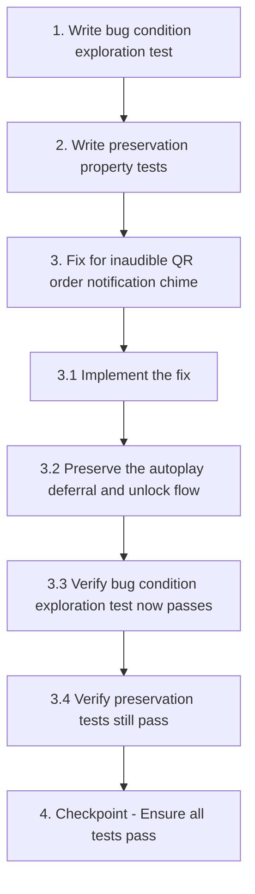

# Implementation Plan

## Overview

This implementation plan fixes the inaudible QR order notification chime in the BFS POS/billing system. The bug condition methodology is used: first surface counterexamples that demonstrate the bug on unfixed code (exploration), then capture baseline non-chime behavior to preserve (preservation), implement the fix based on the design, and validate that the fix resolves the bug without regressions.

The fix targets the `playOrderChime` function in `app.js` (~line 2688), switching from a soft two-note sine-wave chime at high frequencies to a louder, longer, mid-range chime, while preserving all existing non-audio alert behavior (toast, title flashing, system Notification) and the `AudioContext` unlock-on-first-gesture flow.

## Tasks

- [x] 1. Write bug condition exploration test
  - **Property 1: Bug Condition** - Inaudible QR Order Chime Configuration
  - **CRITICAL**: This test MUST FAIL on unfixed code - failure confirms the bug exists
  - **DO NOT attempt to fix the test or the code when it fails**
  - **NOTE**: This test encodes the expected behavior - it will validate the fix when it passes after implementation
  - **GOAL**: Surface counterexamples that demonstrate the bug exists in the `playOrderChime` function
  - **Scoped PBT Approach**: Scope the property to concrete failing cases to ensure reproducibility
  - Write tests that stub a fake `AudioContext` (capturing `OscillatorNode` and `GainNode` configuration) and call the UNFIXED `playOrderChime`
  - Test 1.1 — Sine Waveform Test: Assert the unfixed chime uses `osc.type === 'sine'` (confirms RC2: waveform too soft)
  - Test 1.2 — Two-Note / Short Duration Test: Assert the unfixed chime schedules exactly 2 notes and total duration < 1.5 s (confirms RC3: too few notes / too short)
  - Test 1.3 — High Frequency Test: Assert the unfixed chime's minimum frequency > 1000 Hz (1568 Hz G6 / 1174.7 Hz D6) (confirms RC4: frequencies too high for POS speakers)
  - Test 1.4 — Audio-Locked Deferral Test: Call `playOrderChime` with `orderChimeCtx === null` and assert `orderChimePending === true` and no oscillators created (confirms RC1: chime deferred when audio locked)
  - Run tests on UNFIXED code
  - **EXPECTED OUTCOME**: Tests FAIL on the fix-checking assertions (sine, 2 notes, high freq, short duration) — this proves the bug exists. The deferral test (1.4) documents the existing behavior that the pending flag is set.
  - Document counterexamples found (e.g., "chime uses sine waveform with only 2 notes at 1568/1174.7 Hz totaling ~1.2s") to understand root cause
  - Mark task complete when tests are written, run, and failure is documented
  - _Requirements: 1.1, 1.2, 1.3, 1.4_

- [x] 2. Write preservation property tests (BEFORE implementing fix)
  - **Property 2: Preservation** - Non-Chime Alert Behavior Unchanged
  - **IMPORTANT**: Follow observation-first methodology
  - Observe behavior on UNFIXED code for non-buggy inputs (non-chime alert paths: toast, title flash, system Notification, unlock flow, silence when no order)
  - Write property-based tests capturing observed behavior patterns from Preservation Requirements
  - Property-based testing generates many test cases across the input domain for stronger guarantees
  - Test 2.1 — No-Order Silence Preservation: Verify no oscillator is ever created when `notifyNewQrOrder` / `playOrderChime` is not triggered by a QR order arrival (page load, navigation, unrelated events) (validates 3.1)
  - Test 2.2 — Toast Content Preservation: For varied order shapes (table, item count, item names, totals, missing fields), verify the toast title, summary, total, and action buttons ("Load & Print" / "Later") are identical before the fix (validates 3.2)
  - Test 2.3 — Title Flash Preservation: Verify `flashTitle` is called with the same argument and `stopFlashTitle` behavior on `visibilitychange` is unchanged (validates 3.5)
  - Test 2.4 — System Notification Preservation: Verify a `Notification` is created with the same title/body/tag when the tab is hidden and permission is granted, and not created otherwise (validates 3.3)
  - Test 2.5 — Unlock Flow Preservation: Verify `unlockOrderAlerts` still registers `click`/`keydown`/`touchstart` listeners, removes them after first successful unlock, requests Notification permission once, and plays a pending chime (validates 3.4)
  - Run tests on UNFIXED code
  - **EXPECTED OUTCOME**: Tests PASS (this confirms baseline behavior to preserve)
  - Mark task complete when tests are written, run, and passing on unfixed code
  - _Requirements: 3.1, 3.2, 3.3, 3.4, 3.5_

- [x] 3. Fix for inaudible QR order notification chime

  - [x] 3.1 Implement the fix in `playOrderChime` (app.js ~line 2688)
    - Change oscillator type from `sine` to `square` (louder, most attention-grabbing waveform with rich harmonics)
    - Lower note frequencies from G6/D6 (1568/1174.7 Hz) to mid-range: alternate 660 Hz (E5) and 880 Hz (A5) which reproduce clearly on small POS speakers
    - Expand from 2 notes to a repeating multi-note pattern (~6 notes total, 3 bursts of a 2-tone alternation) spanning ~2 s+, mimicking a telephone-ring cadence
    - Adjust each note's start offset and decay envelope so notes do not overlap and the pattern is clearly rhythmic
    - Add a master `GainNode` (and optionally a `DynamicsCompressorNode`) before `ctx.destination` to control overall level and prevent clipping when multiple notes play
    - Set per-note peak gain high (e.g., 0.7–0.8) so the square waveform is clearly audible but not painfully harsh
    - _Bug_Condition: isBugCondition(input) where input.type == 'qr-order-arrival' AND (NOT audioUnlocked OR chimeWaveform == 'sine' OR chimeNoteCount <= 2 OR chimeTotalDuration < 1.5 OR chimeMinFrequency > 1000)_
    - _Expected_Behavior: expectedBehavior(result) — waveform != 'sine', minFrequency <= 1000, noteCount > 2, totalDuration >= 2.0, peakGain adequate, AND when audio unlocked the chime plays_
    - _Preservation: Preservation Requirements — toast content/buttons unchanged, title flash unchanged, system Notification unchanged, unlock flow unchanged, no sound when no QR order_
    - _Requirements: 2.1, 2.2, 2.3, 2.4_

  - [x] 3.2 Preserve the autoplay deferral and unlock flow (app.js ~line 2736)
    - Keep the existing `orderChimePending` deferral so the improved chime plays as soon as `unlockOrderAlerts` resumes the `AudioContext`
    - Ensure the deferred chime uses the new improved pattern (no code path plays the old two-note sine)
    - Verify the `pending=false` guard in the playing branch prevents double-play when both `playOrderChime`'s resume callback and `unlockOrderAlerts` fire
    - Keep the toast's "Click anywhere on the page once to enable the alert sound" message as the visual fallback when audio is locked (satisfies the "strong visual alert" requirement)
    - Do NOT change `notifyNewQrOrder` (other than the chime it triggers), `showToast` call and arguments, `flashTitle`/`stopFlashTitle`, the `visibilitychange` listener, the system `Notification` block, `unlockOrderAlerts` (event registration, context creation/resume, permission request), or the `resumeOrderAudio` helper
    - _Bug_Condition: isBugCondition(input) where NOT audioUnlocked — chime deferred/dropped (RC1)_
    - _Expected_Behavior: when AudioContext not unlocked, defer improved chime to play as soon as audio becomes available rather than silently dropping_
    - _Preservation: AudioContext unlock-on-first-gesture flow with one-time Notification permission request unchanged_
    - _Requirements: 2.1, 3.4_

  - [x] 3.3 Verify bug condition exploration test now passes
    - **Property 1: Expected Behavior** - Audible Attention-Grabbing QR Order Chime
    - **IMPORTANT**: Re-run the SAME test from task 1 - do NOT write a new test
    - The test from task 1 encodes the expected behavior
    - When this test passes, it confirms the expected behavior is satisfied
    - Run bug condition exploration tests from step 1
    - **EXPECTED OUTCOME**: Tests PASS (confirms bug is fixed — waveform is not sine, min frequency <= 1000 Hz, note count > 2, total duration >= 2.0 s, deferral still works when audio locked)
    - _Requirements: 2.1, 2.2, 2.3, 2.4_

  - [x] 3.4 Verify preservation tests still pass
    - **Property 2: Preservation** - Non-Chime Alert Behavior Unchanged
    - **IMPORTANT**: Re-run the SAME tests from task 2 - do NOT write new tests
    - Run preservation property tests from step 2
    - **EXPECTED OUTCOME**: Tests PASS (confirms no regressions)
    - Confirm all tests still pass after fix (no regressions in toast, title flash, system Notification, unlock flow, or no-order silence)
    - _Requirements: 3.1, 3.2, 3.3, 3.4, 3.5_

- [x] 4. Checkpoint - Ensure all tests pass
  - Ensure all tests pass, ask the user if questions arise.

## Task Dependency Graph



```json
{
  "waves": [
    {
      "wave": 1,
      "tasks": [
        { "id": "1", "title": "Write bug condition exploration test" }
      ]
    },
    {
      "wave": 2,
      "tasks": [
        { "id": "2", "title": "Write preservation property tests (BEFORE implementing fix)" }
      ]
    },
    {
      "wave": 3,
      "tasks": [
        { "id": "3", "title": "Fix for inaudible QR order notification chime", "parent": true },
        { "id": "3.1", "title": "Implement the fix" }
      ]
    },
    {
      "wave": 4,
      "tasks": [
        { "id": "3.2", "title": "Preserve the autoplay deferral and unlock flow" }
      ]
    },
    {
      "wave": 5,
      "tasks": [
        { "id": "3.3", "title": "Verify bug condition exploration test now passes" }
      ]
    },
    {
      "wave": 6,
      "tasks": [
        { "id": "3.4", "title": "Verify preservation tests still pass" }
      ]
    },
    {
      "wave": 7,
      "tasks": [
        { "id": "4", "title": "Checkpoint - Ensure all tests pass" }
      ]
    }
  ],
  "dependencies": [
    { "from": "1", "to": "2" },
    { "from": "2", "to": "3" },
    { "from": "3", "to": "3.1" },
    { "from": "3.1", "to": "3.2" },
    { "from": "3.2", "to": "3.3" },
    { "from": "3.3", "to": "3.4" },
    { "from": "3.4", "to": "4" }
  ]
}
```

**Dependencies:**
- Task 1 (exploration test) must complete before Task 2 (preservation tests) — both establish baseline behavior on unfixed code.
- Task 2 (preservation tests) must complete before Task 3 (implementation) — preservation tests must pass on unfixed code to confirm the baseline.
- Task 3.1 (implement the fix) must complete before Task 3.2 (preserve autoplay deferral) — the improved chime pattern must exist before hardening the deferral path.
- Task 3.2 must complete before Task 3.3 (verify exploration test passes) — the full fix must be in place before re-running the exploration test.
- Task 3.3 must complete before Task 3.4 (verify preservation tests pass) — fix-checking is validated before preservation-checking.
- Task 3.4 must complete before Task 4 (checkpoint) — all validations must pass before the final checkpoint.

## Notes

- The bug condition exploration test (Task 1) is expected to FAIL on unfixed code. This failure confirms the bug exists and must not be "fixed" by altering the test.
- The preservation property tests (Task 2) are expected to PASS on unfixed code. This establishes the baseline behavior that must be preserved after the fix.
- Tests use a stubbed `AudioContext` to capture oscillator/gain configuration rather than requiring actual audio output, making them deterministic and environment-independent.
- The fix is scoped to `playOrderChime` and the autoplay deferral path. All other alert behavior (toast, title flash, system Notification, unlock flow) must remain unchanged per the Preservation Requirements in the design document.
- References: See `bugfix.md` for requirements and `design.md` for detailed root cause analysis and correctness properties.
