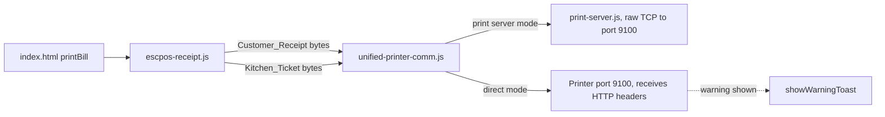

# Design Document

## Overview

Changes are confined to `escpos-receipt.js` (layout and emphasis) and `unified-printer-comm.js` (warning for direct printer addresses). No new files are added to the application.

Findings from reading the code:

- `escpos-receipt.js` writes no git account or IP text. The same applies to `print-server.js` and `simple-print-server.js`, which forward bytes unchanged.
- `unified-printer-comm.js` has a direct mode (`sendToPosiflow` and `sendToWiFiPrinter`) that uses `fetch('http://<printer-ip>:9100')`. Port 9100 is a raw-print port, so the printer receives the HTTP request line and headers (`Host`, `Origin`, `Referer`) as print data. When the app is opened from a hosted URL, those headers contain the hosting account name and the printer IP. This matches the symptom. I have not seen the printed output, so this is the most likely cause and not a confirmed one.
- Misalignment has a concrete cause: `formatCurrencyValue` returns `'₹' + n` (1 character), but `encodeText` prints `₹` as `Rs.` (3 characters). Padding is computed with the wrong length, so every price column and the SUBTOTAL line overflow by 2 characters per value. The `PRICE` and `TOTAL` columns (9 characters each) also truncate amounts of 1000 or more, because `padText` cuts overlong text.

## Architecture



Design decisions:

- The leaked text cannot be removed in code for direct mode, because the browser controls its own request headers. The fix is to route through the Print_Server (already supported) and to warn the user when direct mode is configured. This satisfies Requirement 1 without changing the transport.
- Title and bill-number rendering are shared by both documents through two small byte-builder functions, so the two documents cannot drift apart.

## Components and Interfaces

### escpos-receipt.js

New commands in `CMD`:

- `DOUBLE_STRIKE_ON: [ESC, 0x47, 0x01]`, `DOUBLE_STRIKE_OFF: [ESC, 0x47, 0x00]`
- `FONT_XLARGE: [GS, 0x21, 0x22]` (3x width and height, used for Title_Initials)

New functions (module-private):

- `buildShopTitle()` returns `number[]`. Output: center align, bold on, double-strike on, then for each word of `Best Fruits Stall`: `FONT_XLARGE` + first letter, `FONT_LARGE` + remaining letters, a space between words, then reset size, bold and double-strike. Width: 3 initials x 3 + 14 characters x 2 = 37 of 48 columns.
- `buildBillNumber(billNo)` returns `number[]`. Output: center align, bold on, double-strike on, `FONT_LARGE`, text `Bill #<billNo>` truncated to 24 characters (double-width line limit), line feed, then reset. This uses the same size, bold and double-strike as the non-initial title letters (Requirement 4.1, 4.2).
- `buildDateTimeLine(date)` returns the normal-size line `Date: DD-MMM-YYYY   Time: HH:MM`, at most 48 characters. It is used by both documents, replacing the current `padEnd(24)` bill/date line.

Changed functions:

- `generateCustomerReceipt` and `generateKitchenTicket` call `buildShopTitle()`, the tagline, `buildBillNumber()`, then `buildDateTimeLine()`. The customer name line remains and is truncated to 48 characters.
- `formatCurrencyValue(amount)` returns `'Rs.' + amount.toFixed(2)`, so measured length equals printed length (Requirement 2.2). `formatCurrency` is unused by receipts and is left unchanged.
- `CUSTOMER_RECEIPT_COLS` becomes `ITEM: 19, QTY: 5, PRICE: 11, TOTAL: 13` (sum 48). `Rs.99999.00` (11 characters) fits the PRICE column.
- The SUBTOTAL line is built as one right-aligned 48-character string: `padText(label + ' ' + value, 48, 'right')`.
- The spec line under each item is truncated to 48 characters (already the case) and indented two spaces.
- The GRAND TOTAL block keeps double-size right alignment. At 24 characters per line, the label and value stay on separate lines, as they are today.

### unified-printer-comm.js

- New `warnDirectPrinter(printer)`: when `isLocalServer(printer.ip, printer.port)` is false, call `showWarningToast` (guarded with `typeof showWarningToast === 'function'`) once per printer per page load, with text: `Printing directly to <name> may print network details on the receipt. Use the local print server instead.` The printer IP is not included in the message text.
- Called at the start of the direct branch in `sendToPosiflow` and in `sendToWiFiPrinter` before the fetch. Sending behaviour is unchanged.

## Data Models

No schema changes. `billData` keeps its shape (`billNo`, `customerName`, `items[]`, `subtotal`, `grandTotal`, `date`).

Layout of the Customer_Receipt header after the change (48 columns):

```
        B est  F ruits  S tall        <- initials 3x, rest 2x, bold + double-strike
     Fresh Juices | Shakes | Snacks
================================================
          Bill #B-1042                <- 2x, bold + double-strike
Date: 02-Oct-2026        Time: 14:35
Customer: Asha Customer
================================================
ITEM               QTY      PRICE        TOTAL
Mango Shake          2    Rs.75.00    Rs.150.00
```

## Error Handling

- Missing `billNo`: `buildBillNumber` prints `Bill #` followed by nothing and does not throw; the current code behaves the same way.
- Missing `date`: the current fallback to `new Date()` is kept.
- Overlong bill number, item name or customer name: truncated, never wrapped.
- `showWarningToast` not defined (for example in the Node test context or the documents test pages): the warning is skipped and `console.warn` is used.

## Testing Strategy

Tests extend `test/dual-printer.test.js` (Node `node:test`, run with `node --test test/dual-printer.test.js`):

- Existing assertions stay valid: `Rs.75.00`, `Rs.150.00`, `GRAND TOTAL`, `B-1042`, `PREF`, `Thank you!`.
- Alignment: decode the customer receipt, strip ESC/POS command sequences, split on line feeds, and assert every normal-size line is at most 48 characters. Assert that for the header row and an item row, the QTY, PRICE and TOTAL columns end at the same character index.
- Large amounts: an item with price 1250 renders `Rs.1250.00` untruncated.
- Emphasis: assert the bytes before the first `B` of the title contain `GS ! 0x22`, and that the bytes before the bill number contain `ESC E 1`, `ESC G 1` and `GS ! 0x11`, in both documents.
- Direct-mode warning: run `unified-printer-comm.js` in the existing `vm` context with a stub `showWarningToast`, configure a non-local IP, call `sendToPosiflow`, and assert the stub is called once. Assert it is not called for `localhost:3000`.
- Not verifiable by automated tests: the physical appearance of thermal print output, and whether the stray header text disappears on the user's printer. These need a test print through the Print_Server.
